<p align="center">
  
</p>

<p align="center">
  <b>Full Stack Engineer · WordPress Developer</b> · Karachi, Pakistan
</p>

<p align="center">
  <a href="https://talha-dev-topaz.vercel.app/"></a>
  <a href="https://linkedin.com/in/YOUR_LINKEDIN"></a>
  <a href="mailto:MUHAMMADTALHABINKHALID@GMAIL.COM"></a>
</p>

---

## About

I love **C** and **Java** (including desktop apps with **Swing**) more than anything. They are where I think best, and where I learned what clean, honest code looks like. Around them I build for the web: custom WordPress ecosystems, Node.js apps, and motion-heavy front ends.

Six years in, I still care about the same things: clean architecture, speed, and software that stays maintainable long after it ships.

```c
#include <stdio.h>

int main(void) {
    printf("Talha: C, Java, and the web.\n");
    return 0;
}
```

## What I work with

<p>
  
  
  
  
  
  
  
</p>
<p>
  
  
  
  
  
  
  
  
</p>

Also: Java Swing, SDL2, WebGL, Bootstrap, Processing. Currently learning **Kotlin**.

## Focus areas

- **Systems and graphics:** C and C++ with SDL2
- **Java and Swing:** core fundamentals, object-oriented design, and desktop GUIs with Swing
- **Full stack apps:** Node.js, Express, and relational databases
- **WordPress engineering:** themes, plugins, and performance-focused builds
- **Motion on the web:** GSAP and WebGL experiences

## Projects

### Built in C and Java

| Project | What it is | Stack |
|:--|:--|:--|
| <a href="https://github.com/17DevLoverProTec/chess"></a> | Chess engine with check detection, castling, and timers | C, SDL2 |
| <a href="https://github.com/17DevLoverProTec/checkers"></a> | Two-player checkers with king promotion and jump captures | C, SDL2 |
| <a href="https://github.com/17DevLoverProTec/terminal-chess"></a> | Terminal chess with zero external dependencies | C |
| <a href="https://github.com/17DevLoverProTec/learn_java"></a> | Core Java tutorials, one file per topic | Java |

### Web and creative

| Project | What it is | Stack |
|:--|:--|:--|
| <a href="https://github.com/17DevLoverProTec/portfolio"></a> | Cinematic, scroll-driven personal site | GSAP, WebGL, Lenis |
| <a href="https://github.com/17DevLoverProTec/quiz_site"></a> | Full stack quiz platform <a href="https://quizsite-chi.vercel.app/"></a> | Node.js, Express, MySQL, SQLite, Docker |
| <a href="https://github.com/17DevLoverProTec/pixel-dub"></a> | Turns portraits into halftone dot art | Processing |
| <a href="https://github.com/17DevLoverProTec/gallery_owls"></a> | Draggable 3D card carousel | JavaScript |
| <a href="https://github.com/17DevLoverProTec/travel_timeline_site"></a> | Animated timeline of a 10-day Pakistan tour | Bootstrap |
| <a href="https://github.com/17DevLoverProTec/learn-python"></a> | Python tutorials, beginner to advanced | Python |

### Client work (live)

<p>
  <a href="https://thewildwearable.com/"></a>
  <a href="http://wheeltick.com/"></a>
  <a href="http://marinechecker.com/"></a>
  <a href="https://clipzolounge.com/"></a>
  <a href="http://pureziaorganics.com/"></a>
</p>

## Experience

| When | Role | Where |
|:--|:--|:--|
| Dec 2023 – Feb 2026 | Co-Founder, COO & Website Developer | Quantum Code Labs |
| 2020 – 2023 | Intern | Lamhe Production |
| Mar 2019 – Jan 2020 | Junior Website Developer | DigiTech |

Usman Institute of Technology, Karachi

## Get in touch

Got an idea or a role in mind? I'd love to hear it.

<p>
  <a href="https://talha-dev-topaz.vercel.app/"></a>
  <a href="https://linkedin.com/in/YOUR_LINKEDIN"></a>
  <a href="https://www.behance.net/sheikhmuhammadtalha"></a>
  <a href="https://leetcode.com/u/sonneteertalha/"></a>
  <a href="mailto:MUHAMMADTALHABINKHALID@GMAIL.COM"></a>
</p>
